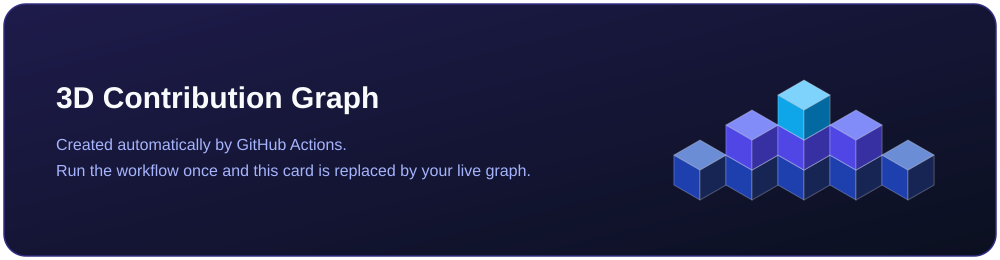
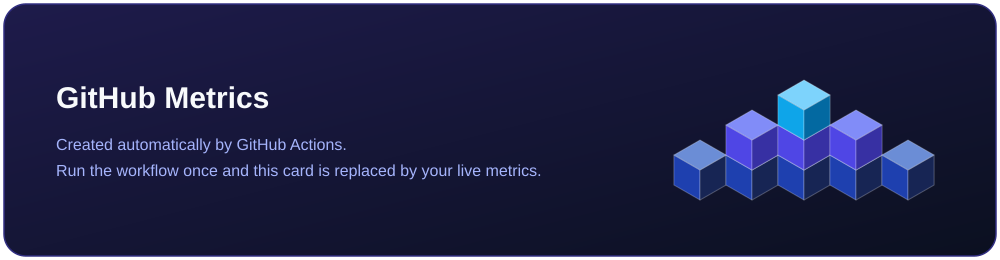

 

 

<table>
<tr>
<td width="42%" valign="top">

Hi, I'm **Shahnila**.

I'm a 3rd-year BS Computer Science student at Sukkur IBA University, currently working as a MERN Stack Development Intern at XICTEK Systems.

I enjoy web development, problem solving and building useful projects.

- Learning full stack development (MERN + Next.js)
- Strengthening my DSA and programming fundamentals
- Exploring real-world projects and new technologies
- Open to collaboration and growth opportunities

*Progress over perfection.*

</td>
<td width="58%" valign="top">

**Web Development**

**Programming Languages**

**Tools**

</td>
</tr>
</table>

 

<table>
<tr>
<td width="33%" align="center"></td>
<td width="33%" align="center"></td>
<td width="33%" align="center"></td>
</tr>
</table>

[View all projects](https://github.com/Shahnila-Chachar?tab=repositories)

 

  

 

  

<!-- 3D contribution graph: generated by .github/workflows/profile-3d.yml -->

 

<!-- GitHub metrics: generated by .github/workflows/metrics.yml -->

  

 

I'm always happy to learn, connect and collaborate with fellow developers.

